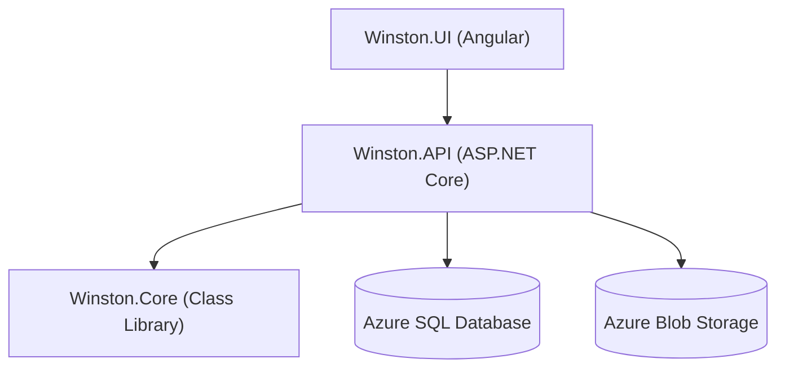

# Winston
A simple project to keep track of how much money is owed between friends. Made to better learn the Angular frontend and Azure backend.

After one person pays for a whole trip, each remaining person owes
```
(TotalCost - sum of all PersonalCost) / TotalUsers + PersonalCost
```

Every time you pay someone back for a trip, log your transaction to update the running totals of how much everyone owes each other.

# Project Structure


# Schema

### `User`

| Field | Description |
| :--- | :--- |
| `Id` | Unique identifier |
| `Name` | Name of the user |

### `Trip`

| Field | Description |
| :--- | :--- |
| `Id` | Unique identifier |
| `OwnerId` | ID of the user who paid/created the trip |
| `Name` | Name/title of the trip |
| `Date` | Date of the trip |
| `Total` | Total cost of the trip |
| `TripUsers` | List of users participating in the trip (linked with join table) |
| `Notes` | Additional notes (optional) |
| `ReceiptImageUrl` | URL to the uploaded receipt image (optional) |

### `TripUser`

| Field | Description |
| :--- | :--- |
| `UserId` | Reference to the user |
| `TripId` | Reference to the trip |
| `PersonalCost` | Specific, additional portion of total cost that is just for this user |

### `Transaction`

| Field | Description |
| :--- | :--- |
| `Id` | Unique identifier |
| `SenderId` | Reference to the user sending money |
| `RecipientId` | Reference to the user receiving money |
| `Date` | Date of the transaction |
| `Cost` | Amount paid |
| `RecipientDidNotReceive` | Flag indicating if the recipient has marked it as not received |
| `Notes` | Additional notes (optional) |

# Pages
## Login
Log in using Microsoft Entra ID

## Home
A list of how much the logged in `User` owes and is owed.
For each `User`:
* if the `User` owes money to the currently logged in `User`, it says
"`User` owes you $`xx.xx`"
* if the `User` is owed money by the currently logged in `User`, it says
"`User` is owed $`xx.xx`"
* if the `User` neither owes nor is owed money by the currently logged in `User`, no text is displayed

## Edit Trip
A form to create or edit a new `Trip` object. On creation, `OwnerId` is automatically set to the logged in `User`.
* An editable title with default "New Trip" (edits `Name`)
* "Date:" with date input (edits `Date`)
* "Total:" with money input (edits `TotalCost`)
* "Users:" accordion list with add button to get a list of `TripUser`, has the owning `User` by default which cannot be deleted
    * dropdown (edits `UserId`)
    * input (optional, edits `PersonalCost`)
* "Upload receipt:" with attachment (uploads image file and edits `ReceiptImageUrl`)
* "Notes:" with text field
* "Summary:" with list of "`User` owes you $`xx.xx`" for each user
* "Save Trip" button

## Edit Transaction
A form to create or edit a new `Transaction` object. On creation, `OwnerId` is automatically set to the logged in `User`.
* "Date:" with date input (edits `Date`)
* "Recipient:" with dropdown (edits `RecipientId`)
* "Cost:" with money input (edits `Cost`)
* "Notes:" with text field
* "Save Transaction" button

## Trips
A list with the following for each `Trip`:
* "`Name`:" with accordion list for each `User` in `TripUsers[]`
    * "`User`: $`xx.xx`" where the amount is `(TotalCost - sum of all PersonalCost) / TotalUsers + PersonalCost`
* "Edit Trip" button, opens the Edit Trip page for the `Trip`

## Transactions
A list with the following for each `Transaction`:
* "`Sender` paid `Recipient` $`xx.xx` on `Date`"
* "Not Received!" text if `RecipientDidNotReceive` is set
* "Did Not Receive?" button, which appears for the Recipient if `RecipientDidNotReceive` is not set, and changes to a "Received?" button if `RecipientDidNotReceive` is set
The list is sorted first in order of ones marked `RecipientDidNotReceive` and then in order of `Date`.

## Settings
* "Logout" button

# Angular Notes

This project was generated using [Angular CLI](https://github.com/angular/angular-cli) version 22.0.4.

## Development server

To start a local development server, run:

```bash
ng serve
```

Once the server is running, open your browser and navigate to `http://localhost:4200/`. The application will automatically reload whenever you modify any of the source files.

## Code scaffolding

Angular CLI includes powerful code scaffolding tools. To generate a new component, run:

```bash
ng generate component component-name
```

For a complete list of available schematics (such as `components`, `directives`, or `pipes`), run:

```bash
ng generate --help
```

## Building

To build the project run:

```bash
ng build
```

This will compile your project and store the build artifacts in the `dist/` directory. By default, the production build optimizes your application for performance and speed.

## Running unit tests

To execute unit tests with the [Vitest](https://vitest.dev/) test runner, use the following command:

```bash
ng test
```

## Additional Resources

For more information on using the Angular CLI, including detailed command references, visit the [Angular CLI Overview and Command Reference](https://angular.dev/tools/cli) page.