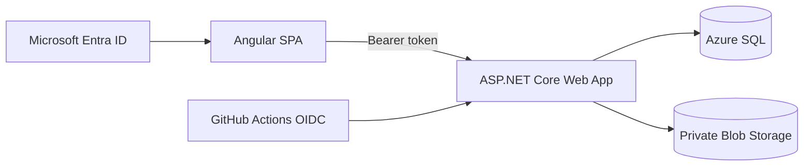

# WINSTON

**Winston Is a Novel System for Tallying Owed Numbers** is a small, full-stack expense-sharing application for friends. It tracks shared trip costs, personal expenses, repayments, and running balances.

The project uses Angular, ASP.NET Core, Microsoft Entra ID, Azure SQL, private Azure Blob Storage, and Terraform. It is designed as a portfolio project and as a reproducible example of deploying a secured single-web-app architecture to Azure.

## Features

- Microsoft account sign-in through Entra ID
- Explicit object-ID allow-list for a private group of friends
- Shared trip and personal-cost calculations
- Repayment tracking and receipt confirmation
- Private receipt-image storage
- Terraform-provisioned Azure infrastructure and app registrations
- Passwordless GitHub Actions deployment through workload identity federation

## Architecture



The Angular production build is served by the ASP.NET Core application. This keeps the Azure footprint small: one App Service, one serverless SQL database, and one storage account.

## Repository layout

| Path | Purpose |
| --- | --- |
| `Winston.UI` | Angular frontend |
| `Winston.API` | ASP.NET Core API and static-file host |
| `Winston.Core` | Domain models and expense calculations |
| `Winston.Infra` | Terraform and setup helpers |
| `.github/workflows` | CI and Azure deployment workflows |

## Prerequisites

- Git
- Node.js 24 and npm 11
- .NET 10 SDK
- Terraform 1.9 or newer
- Azure CLI
- GitHub CLI for automated GitHub environment setup
- An Azure subscription and permission to create resources and Entra app registrations

The configuration prefers free or low-cost Azure services, but Azure pricing and free-tier eligibility vary by subscription and region. Review the Terraform plan and Azure pricing before applying it.

## Deploy your own instance

### 1. Clone and sign in

```bash
git clone https://github.com/matthewbfarnsworth/WINSTON.git
cd WINSTON
az login
gh auth login
```

Confirm that the correct Azure subscription is selected:

```bash
az account show --query '{name:name, id:id, tenantId:tenantId}'
```

### 2. Configure Terraform

```bash
cd Winston.Infra
cp terraform.tfvars.example terraform.tfvars
```

Edit `terraform.tfvars` with:

- your Azure subscription and tenant IDs;
- the email address that should receive access requests;
- your Microsoft account object ID in `allowed_user_object_ids`; and
- your GitHub repository in `owner/repository` format.

For many Azure accounts, the signed-in object ID is available with:

```bash
az ad signed-in-user show --query id --output tsv
```

Provision the infrastructure:

```bash
terraform init
terraform plan -out=winston.tfplan
terraform apply winston.tfplan
```

Terraform creates a `dev` environment by default in West US 3. Override `environment`, `location`, or other documented variables in `terraform.tfvars` when needed.

> [!IMPORTANT]
> Terraform state contains generated credentials and connection strings. It is ignored by Git, but it must be stored securely and backed up. This project intentionally uses local state to keep a personal deployment simple and inexpensive.

### 3. Configure GitHub deployment

From `Winston.Infra`, run:

```bash
./configure-github.sh
```

The script creates the configured GitHub environment and writes only non-secret identifiers as environment variables. Azure deployment uses short-lived OIDC credentials; it does not require a publish profile or client secret.

Push the application to `master` or manually run the **Deploy to Azure** workflow. The deployed URL is available with:

```bash
terraform output -raw web_app_url
```

The free App Service tier can cold-start or stop after reaching its daily compute quota. The SQL configuration uses Azure's serverless free-limit option and auto-pauses after one hour of inactivity.

## Local development

Local development uses the Azure SQL database, storage account, and Entra registrations created by Terraform. From `Winston.Infra`, run:

```bash
./configure-local.sh
```

This script replaces WINSTON's local .NET user-secrets and creates the ignored Angular `environment.ts`. It does not write credentials into tracked files.

Start the API and UI in separate terminals from the repository root:

```bash
dotnet run --project Winston.API
```

```bash
npm start --prefix Winston.UI
```

Open `http://localhost:4200`. The API runs at `http://localhost:5211` and applies pending Entity Framework migrations at startup.

## Manage access

WINSTON accepts authenticated Microsoft accounts only when their `oid` claim appears in the Terraform allow-list. Add one or more people with:

```bash
cd Winston.Infra
./add-allowed-user.sh <account-oid> [<additional-account-oid> ...]
```

The script validates the IDs, creates a Terraform plan, and asks before applying it. Use `--apply` only when an unattended apply is intentional.

Allowed users share the same application data. Only a trip or transaction's creator can edit or delete it, and only a transaction recipient can change its received status.

## Expense calculation

For each person on a trip:

```text
share = (trip total - sum of personal costs) / number of people + personal cost
```

Rounding differences are assigned to the trip owner so all shares add up exactly to the trip total. The application prevents personal costs from exceeding the trip total.

## Tear down Azure resources

Review the destroy plan before approving it:

```bash
cd Winston.Infra
terraform plan -destroy
terraform destroy
```

Destroying the infrastructure permanently removes the deployed app and its Azure-hosted data. Keep the Terraform state until teardown is complete.

## License

WINSTON is available under the [MIT License](LICENSE).
