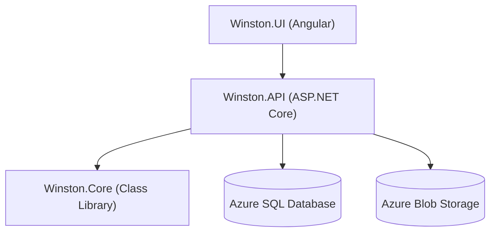

# WINSTON
## (Winston Is a Novel System for Tallying Owed Numbers)

A simple project to keep track of how much money is owed between friends. Made to better learn the Angular frontend and Azure backend.

See [SPECS.md](SPECS.md) for product specifications

# Project Structure



# Setup

Install Node.js 24, the .NET 10 SDK, Terraform 1.16, the Azure CLI, and the GitHub CLI.

```bash
git clone https://github.com/matthewbfarnsworth/WINSTON.git
cd WINSTON

az login
gh auth login

cd Winston.Infra
cp terraform.tfvars.example terraform.tfvars
```

Fill in `terraform.tfvars` with your subscription, tenant, contact email, GitHub repository, and allowed account OIDs.

```bash
terraform init
terraform plan
terraform apply
```

Keep `terraform.tfvars` and Terraform state private.

## Run Locally

```bash
cd Winston.Infra
./configure-local.sh
cd ..

dotnet run --project Winston.API
```

In another terminal:

```bash
npm start --prefix Winston.UI
```

Open `http://localhost:4200`.

## Deploy to Azure

Configure the GitHub `production` environment:

```bash
cd Winston.Infra
./configure-github.sh
```

Push to `master`. GitHub Actions will test and deploy the application.

```bash
git push origin master
```

Get the deployed URL with:

```bash
terraform output -raw web_app_url
```

## Add Users

When someone without access signs in, their access-request email includes their account OID.

Add one or more OIDs with:

```bash
cd Winston.Infra
./add-allowed-user.sh <account-oid> [<additional-account-oid> ...]
```

## Tests

```bash
dotnet test Winston.slnx --configuration Release
npm run test:unit --prefix Winston.UI
cd Winston.UI
npx playwright install chromium
npm run test:e2e
```

# License

Licensed under the [MIT License](LICENSE).
